<a href="https://criseda.com">
  <picture>
    <source media="(prefers-color-scheme: dark)" srcset="assets/header-dark.svg" />
    
  </picture>
</a>

<p align="center">
  <a href="https://criseda.com"></a>
  <a href="https://www.linkedin.com/in/criseda"></a>
  <a href="mailto:laurentiu.cristian.preda@gmail.com"></a>
</p>

<table>
<tr>
<td width="50%" valign="top">

**Now**

Backend systems, LLM integration, applied ML. Mostly Python, sometimes Rust when I want to suffer properly.

</td>
<td width="50%" valign="top">

**Before**

Data Science Intern at Bitdefender. NLP, embeddings, uplift modelling and causal inference on real user data.

</td>
</tr>
</table>

## Lofi Station

<table>
<tr>
<td width="64%" valign="top">

A generator that writes **44-bar, multi-track lofi** from scratch and hands you a WAV.

```
Chords    Weighted Markov walk over 267 hand-picked progressions
Render    44.1kHz WAV in < 12s
Backend   FastAPI · JWT + Google auth · PostgreSQL · rate limiting
Served    500+ tracks
```

**[→ Make a track](https://criseda.com/projects/lofi-station)**

</td>
<td width="36%" valign="top" align="center">

<br>


</td>
</tr>
</table>

## Stack

<table>
<tr>
<td align="center" width="33%"><sub>Languages</sub><br><br>

</td>
<td align="center" width="33%"><sub>Frameworks</sub><br><br>

</td>
<td align="center" width="33%"><sub>Data & Infra</sub><br><br>

</td>
</tr>
</table>

<p align="center">
  <picture>
    <source media="(prefers-color-scheme: dark)" srcset="https://github-readme-stats.vercel.app/api?username=criseda&show_icons=true&hide_border=true&bg_color=00000000&title_color=D897C4&icon_color=D897C4&text_color=F2EDF0&ring_color=D897C4&custom_title=Commits%20%26%20Stuff" />
    
  </picture>
  <picture>
    <source media="(prefers-color-scheme: dark)" srcset="https://streak-stats.demolab.com?user=criseda&hide_border=true&background=00000000&ring=D897C4&fire=D897C4&currStreakLabel=D897C4&sideLabels=B2A9B1&currStreakNum=F2EDF0&sideNums=F2EDF0&dates=B2A9B1&stroke=3E323E" />
    
  </picture>
</p>
